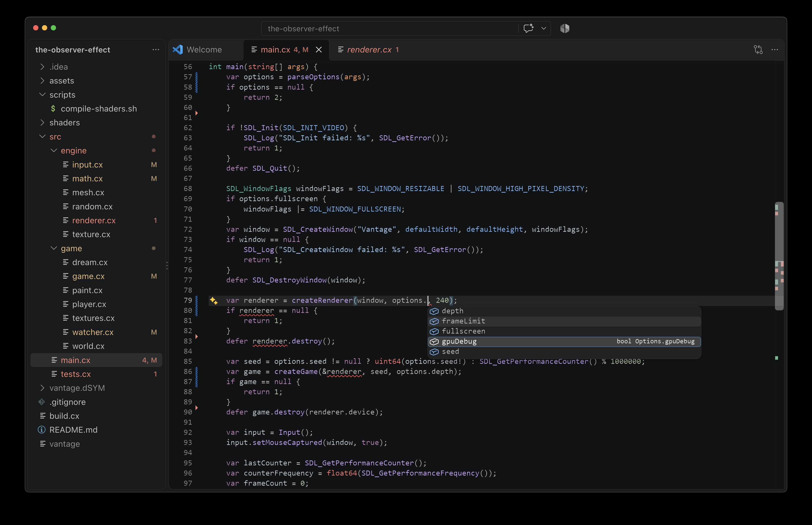

# The cx Programming Language

cx (stylized as lowercase, not to be confused with languages called CX or Cx) is a C-family hybrid low-level/high-level programming language focused on runtime
performance and developer productivity (in this order of priority). The language is simple and unopinionated,
supporting imperative, generic, data-oriented, functional, and object-oriented programming.
It compiles to efficient native code via LLVM or the C backend, with no garbage collection or hidden runtime.


> [!NOTE]
> The project is nearing its 0.1 release: there are still some planned features that haven't been implemented yet,
and the currently implemented features are subject to change, and there are bugs.

To learn more about the language, visit the website:

> [cx-language.github.io/cx](https://cx-language.github.io/cx/)

For more code samples, see [`examples`](examples).

You can also read the language documentation in Markdown format under [`docs`](docs).

To ask a question or open a discussion, create an issue or join the [cx Discord server](https://discord.gg/hsDbW9p).



The [cx extension for VS Code](https://marketplace.visualstudio.com/items?itemName=cx-language.cx-lang) provides syntax highlighting and language server features.

## Building from source

Prebuilt Linux, macOS, and Windows binaries are published on the [releases page](https://github.com/cx-language/cx/releases)
(the fastest install on Linux/macOS is `curl https://cx-language.github.io/cx/install.sh | bash`).
To compile from source, see [Building from source](docs/045-building-from-source.md).

### Editor support

For diagnostics, hover, go to definition, completions, find references, and semantic highlighting
in any LSP-capable editor, see the [editor setup guide](docs/055-editor-setup.md).
The `cx-lsp` binary is built alongside `cx`.

## Contributing

Contributions are welcome. Compiler internals for contributors live in
[`docs/internals.md`](docs/internals.md).
See the GitHub issues and the [Trello board](https://trello.com/b/NIbkM4v2/c) for the project backlog.

### Running tests

Install [lit](https://llvm.org/docs/CommandGuide/lit.html) and its optional dependencies via
[pip](https://pip.pypa.io/en/stable/installing/):

```sh
python3 -m pip install lit psutil
```

On Windows, spell it `py -m pip install lit psutil` instead
(`python -m pip ...` works too). See the [Windows checklist](docs/045-building-from-source.md#windows)
for the rest of the Windows setup.

Some examples have extra prerequisites; see the README in each example directory for details.

Then invoke the following from the `build` directory:

```sh
cmake --build . --target check
```

Configure with `-DCMAKE_BUILD_TYPE=Release` for running tests, since the
unoptimized compiler is several times slower per test invocation.
With the Visual Studio generator on Windows, `CMAKE_BUILD_TYPE` is ignored;
build and test the `Release` configuration instead:

```sh
cmake --build . --config Release --target check
```

This runs the full suite via CTest: the lit/compiler tests, the example programs (LLVM and C backends),
the documentation snippets, and the language server end-to-end tests.
Run a subset from the build directory with e.g. `ctest -R 'docs-snippets'`
(use double quotes in `cmd.exe`).
To run a single compiler test file, invoke `lit` with the flags shown by `ctest -N -V`.

The C++ code style is enforced by ClangFormat:

- Run the `format` CMake target to format the code.
- Run the `lint` CMake target to check if the code is formatted.

### Website and playground

To work on the browser playground or the website, see [wasm/README.md](wasm/README.md)
(architecture, building, and testing of the WebAssembly frontend and the in-browser C toolchain).
Run `website/build-website.sh --serve` to develop the website locally.

## License

cx is licensed under the MIT license, a permissive free software license.
See the file [LICENSE.txt](LICENSE.txt) for the full license text.
